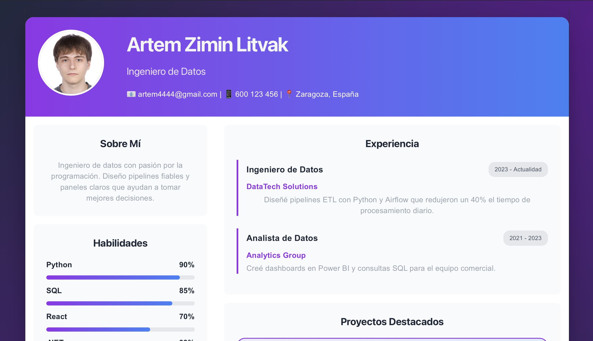

# Currículum en React con Vite

## Tecnología usada: React

React es una biblioteca de JavaScript cuyo objetivo es simplificar el proceso de construir interfaces de usuario. En mi caso la utilizo con JSX y JavaScript.

## Cómo arrancar React
Tienes que poner los siguientes comandos:
1. npm install 
-> (si falla, en Widows) Set-ExecutionPolicy -ExecutionPolicy RemoteSigned -Scope CurrentUser 

{VS Code usa PowerShell como terminal predeterminada, y PowerShell tiene una Política de Ejecución que, por seguridad, bloquea los scripts .ps1, entre ellos el que lanza NPM}

2. npm run dev

## Herramienta de desarrollo que utilizo: Vite

Hay que diferenciar React de Vite. React es la biblioteca con la que se construye la interfaz, mientras que Vite es una herramienta de desarrollo independiente que sirve para crear, ejecutar y compilar el proyecto. Vite ofrece un servidor local muy rápido y recarga la página automáticamente al guardar los cambios.

Para crear un proyecto debes utilizar los siguientes comandos y opciones:
1. `npm create vite@latest nombre-del-proyecto`
2. Elige React -> JavaScript -> OXlint
# TrabajoCurriculumVitae
